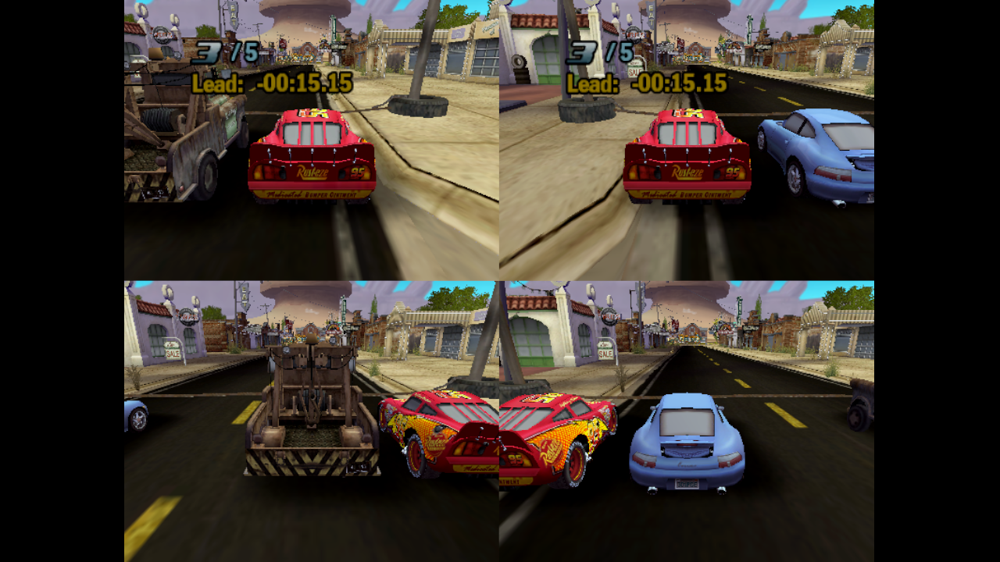

# CarsMP

4-player split-screen and 144 fps for Cars (2006, Steam).



Pick **Vs.** as usual. Road Races and Piston Cup run with up to 4 players. Mini-games stay 2-player. `Cars.exe` is not modified.

## Install

Download `CarsMP.zip` from [Releases](https://github.com/degraffa/cars-mp-mod/releases), then:

```sh
cd ~/.local/share/Steam/steamapps/common/Cars
mv binkw32.dll binkw32_o.dll
unzip ~/Downloads/CarsMP.zip
```

Turn on all controllers before launching. Set your display to 144 Hz, or the game stops at its refresh rate.

Steam's "Verify integrity" removes the mod. Run the same commands to put it back.

## Uninstall

```sh
cd ~/.local/share/Steam/steamapps/common/Cars
mv binkw32_o.dll binkw32.dll
rm CarsMP.ini CarsMP.log dxvk.conf
```

## Settings

`CarsMP.ini`, in the game folder:

| Key | Values | Default |
| --- | --- | --- |
| `Players` | 2 to 4 | 4 |
| `FPS` | 0 for stock, or 30 and up | 144 |
| `Player3Car` | car ID | `mat` |
| `Player4Car` | car ID | `sal` |

Car IDs include `mcq` `mat` `sal` `hud` `ram` `flo` `sher` `chi` `win` `dar` `king`.

## Build

```sh
pip install ziglang
./build.sh
```

See the [wiki](docs/wiki/Home.md) for how it works and how to extend it.
